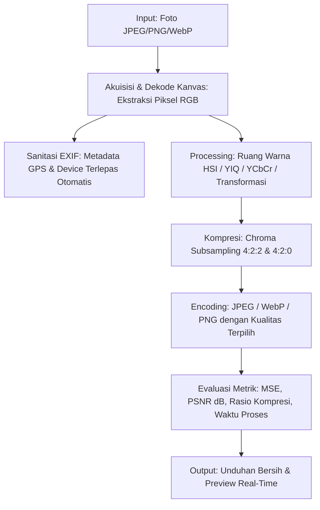

# Editor Citra Berbasis Web (Web-Based Image Editor)
**Proposal Tugas Besar Sistem Multimedia — Kelompok 2**

Aplikasi pengolahan dan kompresi citra berbasis web modern yang berorientasi privasi (*100% Client-Side Processing*). Seluruh proses akuisisi, manipulasi piksel, transformasi geometri, konversi ruang warna, kompresi chroma, hingga pengukuran metrik PSNR dieksekusi secara lokal di peramban (browser) pengguna tanpa pengunggahan ke server pihak ketiga.

---

## 👥 Tim Pengembang & Pembagian Tugas

| No | Nama Anggota | Peran & Modul Utama |
|---|---|---|
| 1 | **Ardian Satriana** | **Koordinator & Antarmuka Halaman**: Desain antarmuka Studio Gelap (Dark Mode), arsitektur HTML5/CSS3 responsif, integrasi modul, dan slider perbandingan *Before/After*. |
| 2 | **Rafif Naufal Pratama** | **Transformasi Geometri**: Pemotongan interaktif (*Crop* dengan preset rasio), sampling ulang (*Resize* manual *Nearest Neighbor* & *Bilinear Interpolation*), pembalikan (*Flip H/V*), dan rotasi (*Rotate* 90° CW/CCW, 180°, sudut bebas). |
| 3 | **Kgs Muhammad Fathurrohman Fazriansyah** | **Pengolahan & Analisis Warna**: Filter *Grayscale* (NTSC), *Invert*, *Brightness*, *Contrast*, pergeseran corak & kejenuhan (*Hue & Saturation* lewat konversi $RGB \leftrightarrow HSI$), kuantisasi kedalaman bit (*Bit Depth Reduction* 1–8 bit), serta inspektor piksel multi-ruang warna (*RGB, CMYK, HSI, YIQ, YCbCr*) dengan *Magnifying Loupe* 16x. |
| 4 | **Baihaqy Al Buzjani Putra Hikmat** | **Kompresi & Ekspor Citra**: Simulasi *Chroma Subsampling* (4:4:4, 4:2:2, 4:2:0) melalui perataan blok $2 \times 1$ dan $2 \times 2$ pada kanal $Cb$ dan $Cr$, pengkodean format JPEG, WebP, dan PNG dengan kontrol kualitas interaktif, serta penghitungan rasio penghematan file. |
| 5 | **Shevandry Haikal Gibraltar Sain** | **Eksperimen, Metrik & Keamanan**: Pengukuran matematis *Peak Signal-to-Noise Ratio* (PSNR) & *Mean Squared Error* (MSE), deteksi dan sanitasi otomatis metadata EXIF kamera/GPS saat dekompresi kanvas, serta penambahan *Watermark* teks kustom. |

---

## 🧠 Pemetaan Materi Kuliah Sistem Multimedia

Aplikasi ini mengimplementasikan konsep-konsep inti perkuliahan Sistem Multimedia secara mandiri (algoritma ditulis *from scratch* pada data piksel `ImageData`):



### 1. Pengenalan Sistem Multimedia
* **Tahap Alur**: Akuisisi $\to$ Pengolahan $\to$ Penyimpanan $\to$ Penyajian.
* **Ukuran Citra Mentah (*Raw Bitmap Size*)**:
  $$\text{Ukuran Mentah} = \text{Lebar} \times \text{Tinggi} \times 3 \text{ Byte} \quad (\text{RGB 24-bit TrueColor})$$

### 2. Akuisisi dan Konversi Data Digital
* **Sampling Ulang (*Resize*)**:
  * *Nearest Neighbor*: Pemetaan koordinat diskrit tercepat.
  * *Bilinear Interpolation*: Perataan berbobot dari 4 piksel tetangga kontinu untuk meminimalisasi efek *aliasing* (*jaggies*):
    $$P(u, v) = (1-dx)(1-dy)P_{11} + dx(1-dy)P_{21} + (1-dx)dy P_{12} + dx dy P_{22}$$
* **Kuantisasi Kedalaman Bit (*Bit Depth Reduction*)**:
  Pengurangan kedalaman bit per kanal warna dari 8-bit (256 level) ke 1 s/d 7 bit:
  $$\text{levels} = 2^{\text{bits}}, \quad \text{step} = \frac{255}{\text{levels} - 1}$$
  $$\text{val}' = \text{round}\left(\text{round}\left(\frac{\text{val}}{255} \times (\text{levels} - 1)\right) \times \text{step}\right)$$

### 3. Konsep Ruang Warna (*Color Spaces*)
* **Grayscale Standar NTSC Luminance**:
  $$Y = 0.299R + 0.587G + 0.114B$$
* **Ruang Warna HSI (Hue, Saturation, Intensity)**:
  * Konversi $RGB \to HSI$:
    $$I = \frac{R + G + B}{3}$$
    $$S = 1 - \frac{3}{R + G + B} \min(R, G, B)$$
    $$\theta = \arccos\left(\frac{0.5 \cdot ((R-G) + (R-B))}{\sqrt{(R-G)^2 + (R-B)(G-B)}}\right)$$
    $$H = \theta \text{ jika } B \le G, \quad \text{atau } 360^\circ - \theta \text{ jika } B > G$$
  * Rekonstruksi $HSI \to RGB$ berbasis 3 sektor trigonometrik ($0^\circ-120^\circ$, $120^\circ-240^\circ$, $240^\circ-360^\circ$).
* **Ruang Warna CMYK (Subtraktif Percetakan)**:
  $$K = 1 - \max\left(\frac{R}{255}, \frac{G}{255}, \frac{B}{255}\right), \quad C = \frac{1 - R/255 - K}{1 - K}, \dots$$
* **Ruang Warna YIQ (Transmisi NTSC)**:
  $$\begin{bmatrix} Y \\ I \\ Q \end{bmatrix} = \begin{bmatrix} 0.299 & 0.587 & 0.114 \\ 0.596 & -0.274 & -0.322 \\ 0.211 & -0.523 & 0.312 \end{bmatrix} \begin{bmatrix} R \\ G \\ B \end{bmatrix}$$
* **Ruang Warna YCbCr (Digital Video BT.601)**:
  $$Y = 0.299R + 0.587G + 0.114B$$
  $$Cb = 128 - 0.168736R - 0.331264G + 0.5B$$
  $$Cr = 128 + 0.5R - 0.418688G - 0.081312B$$

### 4. Kompresi & Chroma Subsampling
* **Prinsip Perseptual Manusia**: Mata manusia lebih sensitif terhadap perbedaan pencahayaan (*luminance* $Y$) dibandingkan perbedaan warna (*chrominance* $Cb, Cr$).
* **Simulasi Subsampling**:
  * **4:4:4**: Resolusi warna penuh (tanpa subsampling).
  * **4:2:2**: Rata-rata komponen $Cb$ dan $Cr$ per blok $2 \times 1$ horizontal.
  * **4:2:0**: Rata-rata komponen $Cb$ dan $Cr$ per blok $2 \times 2$ (menghemat 50% informasi warna).

### 5. Metrik Kualitas Multimedia (PSNR & MSE)
* **Mean Squared Error (MSE)**:
  $$\text{MSE} = \frac{1}{3 \cdot W \cdot H} \sum_{x,y} \left( (R - R')^2 + (G - G')^2 + (B - B')^2 \right)$$
* **Peak Signal-to-Noise Ratio (PSNR)**:
  $$\text{PSNR} = 10 \cdot \log_{10}\left(\frac{255^2}{\text{MSE}}\right) \text{ dB}$$
  * $> 40 \text{ dB}$: Sangat Tinggi (kualitas prima / nyaris tanpa distorsi).
  * $30 - 40 \text{ dB}$: Standar kompresi JPEG yang dapat diterima pengguna.
  * $< 25 \text{ dB}$: Distorsi atau artefak terlihat jelas.

### 6. Keamanan & Privasi
* **Sanitasi Metadata EXIF**: Dekode kanvas web secara alami melepaskan tag EXIF APP1 (`0xFFE1`), menjamin tidak ada koordinat GPS, merk gawai, atau waktu pemotretan rahasia yang tersisa pada berkas unduhan.
* **Watermark Teks**: Tanda air kustom dengan rotasi, transparansi, penempatan koordinat dinamis, dan latar pelindung kontras.

---

## 🚀 Cara Menjalankan Proyek

Aplikasi dirancang sebagai aplikasi web murni (*pure client-side HTML5/CSS/JavaScript*), sehingga dapat dijalankan tanpa dependensi *build tools*:

### Opsi 1: Menjalankan Server Lokal (Disarankan)
Buka terminal pada folder proyek:
```bash
# Menggunakan Python:
python -m http.server 8080

# Atau menggunakan Bun:
bun x serve -p 8080
```
Buka peramban pada: `http://localhost:8080/`

### Opsi 2: Buka Langsung Berkas HTML
Cukup klik dua kali pada berkas `index.html` pada peramban Chrome, Edge, atau Firefox.

---

## 🧪 Pengujian Unit Test Mandiri

Unit test otomatis telah disediakan pada folder `test/` untuk memverifikasi keabsahan seluruh rumus matematika:
```bash
bun test/verify-algorithms.js
# atau
node test/verify-algorithms.js
```
**Hasil Pengujian:**
* 33 skenario uji formula (*Grayscale, HSI roundtrip, CMYK, YIQ, YCbCr, Kuantisasi, Bilinear, Flip, Rotate, PSNR, Subsampling, EXIF*) dinyatakan **100% PASS**.

---

## 📂 Struktur Berkas

```
SISMUL/
├── index.html                   # Struktur antarmuka studio web modern
├── css/
│   └── style.css                # Gaya visual Dark Theme studio, responsif & estetis
├── js/
│   ├── color-models.js          # Implementasi manual HSI, CMYK, YIQ, YCbCr, Grayscale, Kuantisasi
│   ├── transformations.js       # Bilinear/Nearest resize, crop, flip H/V, rotate CW/CCW/bebas
│   ├── compression.js           # Chroma subsampling 4:2:2/4:2:0, kalkulasi PSNR, MSE, Raw Size
│   ├── security.js              # Deteksi EXIF APP1, penjelasan sanitasi, watermark teks kustom
│   ├── inspector.js             # Magnifying Loupe 16x, pelacak koordinat, pembaca multi-warna
│   └── app.js                   # State manager, Undo/Redo, drag-and-drop, Before/After slider
├── assets/
│   ├── sample-testchart.png     # Gambar uji SMPTE, gradien RGB, dan kisi frekuensi tinggi
│   └── sample-scenery.jpg       # Gambar uji pemandangan senja dengan gradasi alami
├── test/
│   └── verify-algorithms.js     # Skrip pengujian otomatis seluruh rumus Sistem Multimedia
├── Kel2 Presentasi Sismul.pdf   # Dokumen proposal asli kelompok 2
└── README.md                    # Dokumentasi lengkap proyek
```
